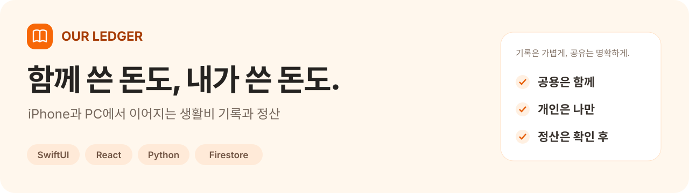
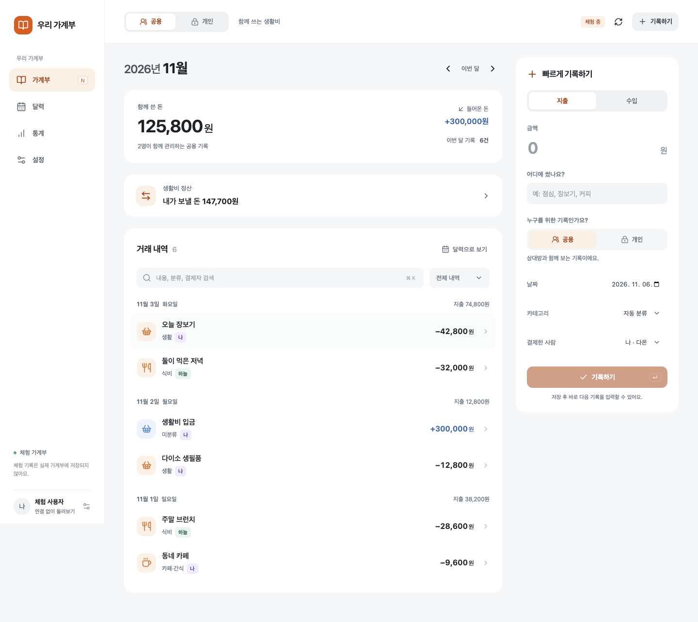
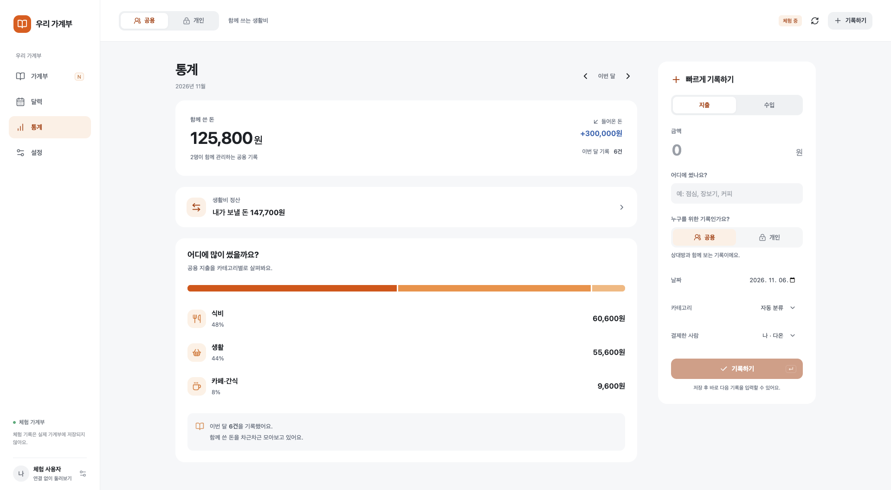
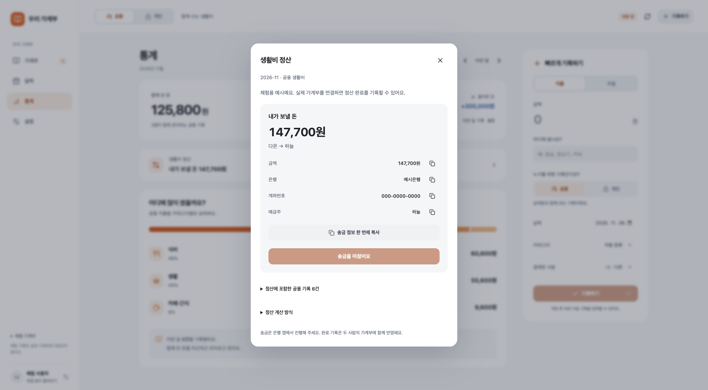
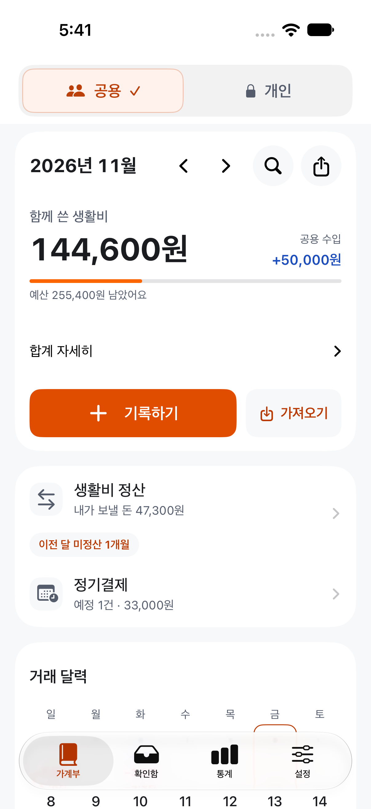
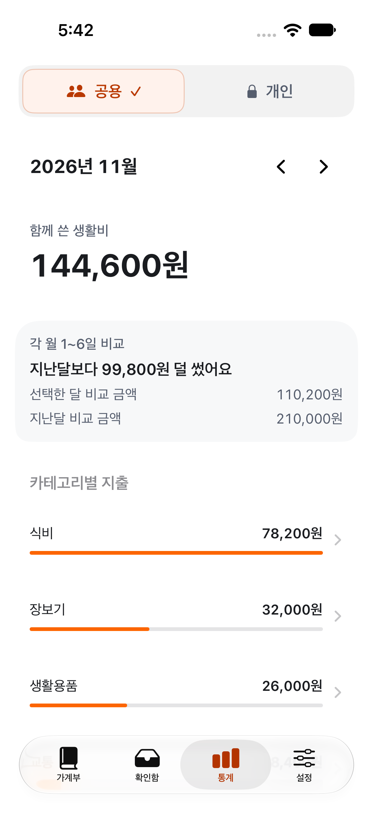
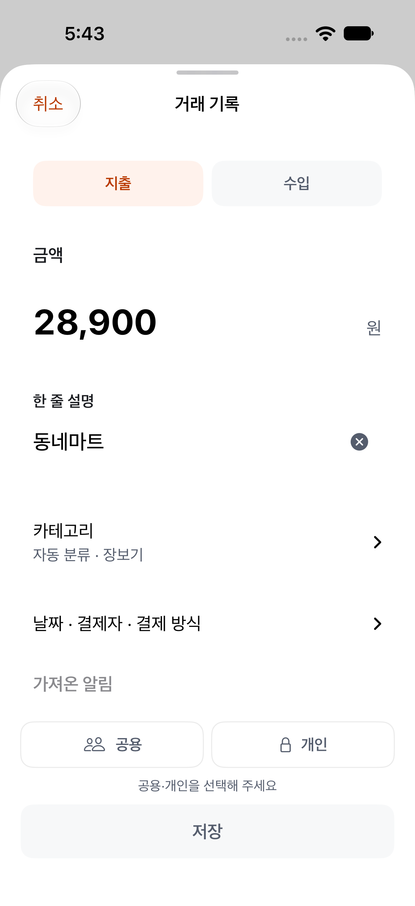
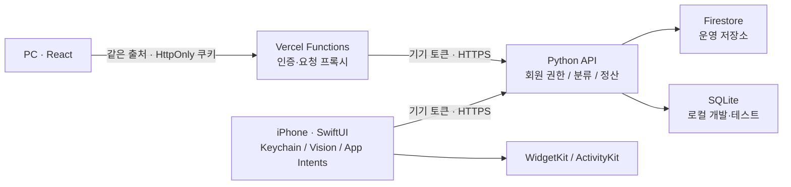

<p align="center">
  
</p>

<p align="center">
  <strong>공용 생활비와 개인 지출을 나누고, 함께 쓴 돈의 정산까지 연결한 iPhone·PC 가계부</strong><br />
  SwiftUI · React · Python · Cloud Run · Firestore
</p>

<p align="center">
  <a href="https://our-ledger-web.vercel.app">웹 체험</a> ·
  <a href="#화면으로-보기">화면</a> ·
  <a href="#설계에서-신경-쓴-부분">설계</a> ·
  <a href="docs/LOCAL_DEVELOPMENT.md">실행 방법</a> ·
  <a href="docs/VERIFICATION.md">검증 기록</a> ·
  <a href="SECURITY.md">보안·공개 범위</a>
</p>

## 왜 만들었나요?

함께 쓰는 생활비를 기록하면서도, 개인 소비까지 상대에게 보여주고 싶지는 않았습니다. 결제 알림을 다시 입력하고 월말에 각자 낸 금액을 계산하는 과정도 줄이고 싶었습니다.

그래서 **알림·캡처 가져오기 → 본인 확인 → 공용/개인 기록 → 월별 통계·정산**을 하나의 흐름으로 만들었습니다. 혼자 시작할 수 있고, 초대로 최대 두 사람이 같은 가계부를 사용합니다.

**개인 프로젝트**로 iOS 앱·PC 웹·서버를 직접 개발했습니다. AI 코딩 도구를 활용했으며, 요구사항·공개 범위·검증 결과와 남은 제약을 이 문서에 구분해 정리했습니다.

iOS는 **TestFlight 베타**로 배포했고 PC 웹에는 **로그인 없이 둘러볼 수 있는 체험 화면**이 있습니다. 이 저장소는 운영 인증정보와 개인 기록을 제외한 공개용 소스입니다.

## 화면으로 보기

### 넓은 화면에서 빠르게 기록하기



<table>
  <tr>
    <td width="50%"><strong>카테고리별 통계</strong><br />선택한 공용·개인 범위에 맞춰 월 지출을 확인합니다.</td>
    <td width="50%"><strong>생활비 정산</strong><br />금액과 계산 근거를 확인하고 완료를 기록합니다.</td>
  </tr>
  <tr>
    <td></td>
    <td></td>
  </tr>
</table>

### iPhone에서 기록·가져오기·확인하기

<table>
  <tr><th width="33%">공용·개인과 월 요약</th><th width="33%">범위별 지출 통계</th><th width="33%">확인 후 거래 기록</th></tr>
  <tr>
    <td></td>
    <td></td>
    <td></td>
  </tr>
</table>

> iPhone 이미지는 **새 시뮬레이터·로컬 서버의 합성 데이터**, 웹 이미지는 로그인하지 않은 **체험 가계부의 합성 데이터**입니다. 이름·거래·계좌는 실사용자 정보가 아닙니다. 체험 변경 사항은 실제 원장에 저장되지 않습니다.

## 주요 기능

| 흐름 | 구현한 내용 |
| --- | --- |
| 기록 | 지출·수입, 공용/개인 구분, 결제자·날짜·카테고리 선택, 검색·수정·삭제 |
| 가져오기 | iOS Vision 문자 인식, 캡처 여러 장 가져오기, 단축어 알림 입력, 중복 후보 비교 |
| 확인 | 인식 결과를 사용자가 확인한 뒤 저장. 불명확한 원문과 미확인 알림은 본인만 열람 |
| 통계 | 월별 달력·카테고리·결제자·기간 비교, 개인 지출 통계, 예산 |
| 정산 | 각자 결제 후 차액 정산 / 공동자금 방식, 지난달 미정산, 완료 이력 |
| iOS 연동 | 홈 위젯, Live Activities, App Intents, 월별 XLSX 내보내기 |
| PC 연결 | iPhone에서 만든 일회용 코드로 같은 회원에 연결. 새 구성원을 추가하지 않음 |

## 설계에서 신경 쓴 부분

### 1. 개인 기록은 화면에서 숨기기 전에 서버에서 분리

서버가 인증된 회원을 기준으로 조회 가능 범위를 계산합니다. 상대의 개인 거래·미확인 알림·개인 분류 규칙을 응답에서 제외하고, 거래 수정·삭제는 작성자 권한과 정산 상태를 검사합니다.

- [조회 범위·거래·정산 규칙](server/ledger.py)
- [권한·정산 회귀 테스트](server/test_ledger.py)

### 2. 금액을 인식했다고 바로 거래로 확정하지 않기

캡처 이미지는 기기의 Vision으로 읽고, 인식한 문구를 서버의 규칙 기반 분석으로 전달합니다. 잔액·예정 금액·모호한 문구는 자동 확정하지 않습니다. 알림 재전달은 이벤트 식별자와 금액·종류·시각·카드 정보를 비교하고, 확신할 수 없는 경우 확인 흐름을 유지합니다. **분류에 유료 AI API를 사용하지 않습니다.**

- [기기 내 문자 인식](OurLedger/Inbox.swift) · [캡처 묶음 처리](OurLedger/PaymentCaptureBatch.swift)
- [중복 입력 회귀 테스트](server/test_import_dedup.py)

### 3. 정산 확인 중 거래가 바뀌면 다시 확인

PC도 iOS와 같은 서버 계산을 사용합니다. 정산 요청에 확인한 내역의 `revision`을 보내고, 그사이 거래가 바뀌었다면 서버가 완료를 거절합니다. 재시도에는 같은 요청 식별자를 사용해 중복 완료를 방지합니다. 계좌 복사는 정산 완료로 간주하지 않으며, **실제 송금은 은행 앱에서** 합니다.

- [정산 화면·확인 흐름](web/src/Settlement.jsx) · [정산 상태 검증](web/tests/settlement.test.mjs)

### 4. 기기와 브라우저의 인증 정보는 별도로 보호

iOS 연결 정보는 Keychain에 저장합니다. 웹 인증 토큰은 JavaScript에서 읽을 수 없는 `HttpOnly` 쿠키로 관리하고, 쓰기 요청의 출처·세션 일치 여부를 검사합니다. 서버는 토큰 원문 대신 해시를 저장합니다.

공개본에는 웹 세션의 **서버 기준 30일 만료·연결 해제 시 토큰 폐기**를 추가했습니다. 이 보완은 기존 운영 앱·서버에 배포하지 않았습니다.

- [iOS Keychain·요청 처리](OurLedger/API.swift)
- [웹 인증·요청 검증](web/lib/upstream.js) · [서버 저장소](server/firestore_store.py)
- [PC 연결·세션 만료·폐기 회귀 테스트](server/test_device_links.py)

### 5. 내보내기도 개인 정보의 경계 안에서

월·조회 범위에 해당하는 거래만 XLSX로 내보냅니다. 계좌·인증 토큰·알림 원문은 내보내지 않으며, 문자열은 수식이 아닌 텍스트 셀로 기록합니다. Swift Foundation으로 파일을 생성하고, 합성 데이터로 파일 구조와 제외 필드를 검사합니다.

- [XLSX 생성](OurLedger/LedgerWorkbook.swift) · [파일·개인정보 검증](checks/LedgerWorkbookCheck.py)

## 구조



| 영역 | 기술 |
| --- | --- |
| iOS | SwiftUI, Observation, Swift Concurrency, Vision, Security/Keychain |
| 시스템 연동 | WidgetKit, ActivityKit, App Intents |
| PC 웹 | React 19, Vite, Vercel Node Functions |
| 서버 | Python, SQLite, Google Cloud Firestore, Cloud Run |
| 검증 | Python unittest, Node test runner, Swift 실행 검사, XCTest UI 검사 |

## 직접 실행하기

운영 계정이나 API 키 없이 **로컬 SQLite 서버와 웹 체험 화면**을 실행할 수 있습니다.

```sh
git clone https://github.com/Harry1757/our-ledger-public.git
cd our-ledger-public
python3 server/app.py --port 8817 --db /tmp/ourledger-demo.sqlite
```

다른 터미널에서:

```sh
cd our-ledger-public/web
npm ci
LEDGER_API_URL=http://127.0.0.1:8817 npm run dev
```

`http://127.0.0.1:5183`에서 **체험 가계부 열기**를 누르면 됩니다. 자신의 기록을 연결하려면 iOS 시뮬레이터에서 로컬 가계부를 만들고 PC 연결 코드를 발급하세요.

Xcode·iOS 설정과 테스트 명령은 [로컬 실행 안내](docs/LOCAL_DEVELOPMENT.md)에 정리했습니다. 공개본의 기본 연결 대상은 로컬 서버이며 운영 인증정보는 포함하지 않습니다.

## 검증과 현재 범위

검증 명령·이번 공개본의 실제 검사 결과·남은 제약은 [검증 기록](docs/VERIFICATION.md)에서 확인할 수 있습니다.

- 앱을 켜기만 해서 다른 금융 앱의 모든 알림을 읽는 기능은 없습니다. 단축어 전달은 iOS 버전과 금융 앱의 지원 조건을 따릅니다.
- 문자 인식·자동 분류는 오류가 있을 수 있어 사용자가 결과를 확인합니다.
- 이 저장소는 공개용으로 정리한 소스이며, 공개본에 추가한 보안 수정이 기존 운영 앱·서버에 자동 배포되지는 않습니다.
- 실제 두 iPhone의 최신 빌드 동기화·알림 수신과 실계정 정산은 이번 공개 작업의 검증 범위에 포함하지 않았습니다.

---

디자인에 참고한 당근 SEED Design의 출처와 고지는 [ThirdPartyNotices](ThirdPartyNotices/SEED-Design)에 보존했습니다.
